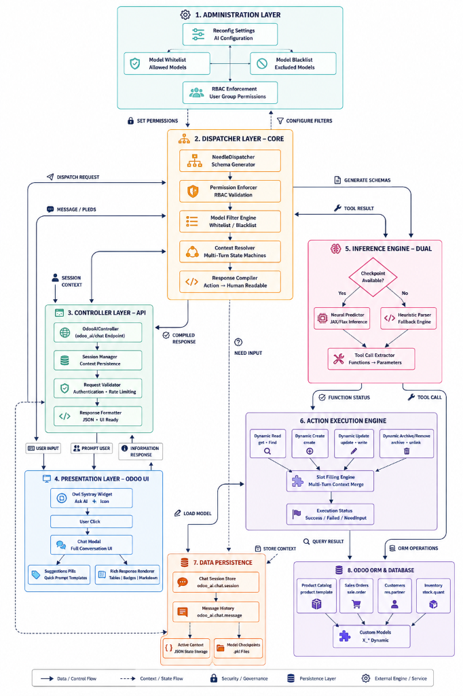
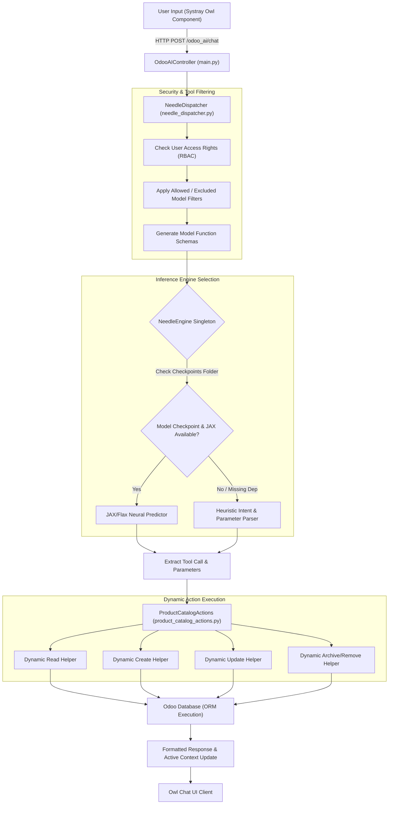
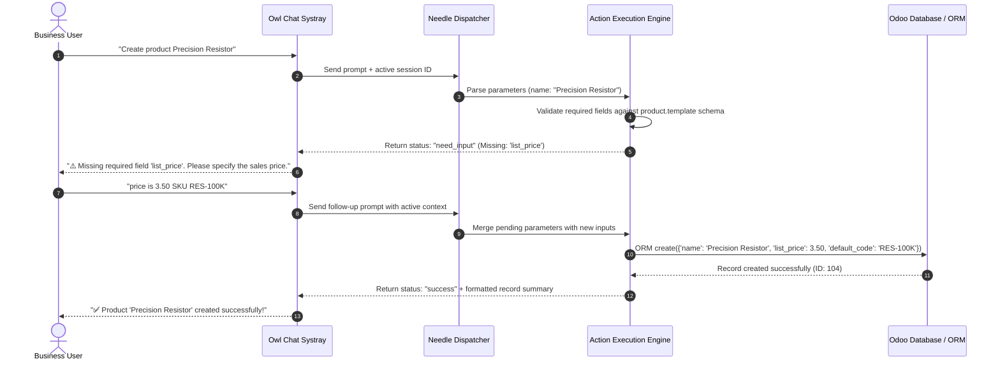

# TSSS Odoo AI (`tsss_odoo_ai`) — Enterprise Setup, Configuration & Developer Manual

| Metadata Attribute | Details |
| :--- | :--- |
| **Module Technical Name** | `tsss_odoo_ai` |
| **Supported Odoo Version** | Odoo 19.0 (Community & Enterprise Editions) |
| **Module Version** | `19.0.1.0.0` |
| **License** | LGPL-3 |
| **Category** | Productivity / Artificial Intelligence / ERP Automation |
| **Author / Maintainer** | TSSS Engineering |
| **Core AI Engine** | Cactus Needle Function-Calling LLM (JAX/Flax Inference Engine with Fallback Heuristic Parser) |

---

## 📑 Table of Contents

1. [Executive Summary & System Overview](#1-executive-summary--system-overview)
2. [System Architecture & Execution Flow](#2-system-architecture--execution-flow)
3. [Prerequisites & System Requirements](#3-prerequisites--system-requirements)
4. [Module Layout & Directory Structure](#4-module-layout--directory-structure)
5. [Installation & Verification Guide](#5-installation--verification-guide)
6. [AI Model Checkpoint Management](#6-ai-model-checkpoint-management)
7. [Administration & Access Control](#7-administration--access-control)
8. [Chatbot User Guide & Interface Overview](#8-chatbot-user-guide--interface-overview)
9. [Dynamic Action Execution Engine (CRUD Specification)](#9-dynamic-action-execution-engine-crud-specification)
10. [Multi-Turn Conversational State Machine](#10-multi-turn-conversational-state-machine)
11. [Troubleshooting, Logging & Diagnostics](#11-troubleshooting-logging--diagnostics)
12. [Developer Extension Guide & Dataset Training](#12-developer-extension-guide--dataset-training)
13. [Verification & Operations Checklist](#13-verification--operations-checklist)

---

## 1. Executive Summary & System Overview

The **TSSS Odoo AI** (`tsss_odoo_ai`) module integrates high-performance natural language processing directly into Odoo 19. Powered by the **Cactus Needle Function-Calling LLM Engine** (optimized for JAX/Flax inference), the module translates plain-text user intent into validated, permission-checked Odoo ORM actions in real time.

### Key Capabilities

* **Native Function Calling:** Dynamically maps conversational prompts to Odoo ORM operations (`create`, `read`, `write`, `unlink` / `archive`).
* **Resilient Dual Inference Pipeline:** Runs native JAX neural models when hardware/drivers permit, with automatic failover to a lightweight **Heuristic Parser** to ensure 100% uptime.
* **Granular Security & Model Filtering:** Enforces strict role-based access control (RBAC) and configurable module/model whitelist and blacklist controls.
* **Interactive Multi-Turn Slot Filling:** Maintains session state across turns, prompting users naturally for missing required fields before committing actions.
* **Seamless UI Integration:** Features a floating, non-intrusive Owl frontend systray widget with real-time feedback and session history management.

---

## 2. System Architecture & Execution Flow

### 2.1 Request Processing Pipeline

The diagram below illustrates the end-to-end request processing flow from the Owl frontend client down to Odoo ORM record mutation:







### 2.2 Multi-Turn Slot-Filling Lifecycle



---

## 3. Prerequisites & System Requirements

### 3.1 Software & Hardware Requirements

| Category | Minimum Requirement | Recommended Specification |
| :--- | :--- | :--- |
| **Odoo Version** | Odoo 19.0 (Community / Enterprise) | Odoo 19.0 Enterprise |
| **Python Runtime** | Python 3.10+ | Python 3.11 or 3.12 |
| **Operating System** | Linux (Ubuntu 22.04 LTS), macOS, Windows WSL2 | Ubuntu 22.04 LTS Server |
| **CPU** | 4 Cores | 8+ Cores |
| **RAM** | 8 GB RAM | 16 GB+ RAM (when executing JAX model checkpoints) |
| **Storage** | 2 GB Free Disk Space | SSD storage for model weights (`.pkl`) and logs |

### 3.2 Python Package Dependencies

| Package | Minimum Version | Category | Description |
| :--- | :--- | :--- | :--- |
| `odoo` | 19.0 | **Mandatory** | Core Odoo ERP Framework |
| `jax` / `jaxlib` | `>= 0.4.10` | Optional | Accelerated array calculations for Cactus Needle |
| `flax` | `>= 0.7.0` | Optional | Neural network framework for JAX |
| `optax` | `>= 0.1.5` | Optional | Gradient processing library for JAX |
| `transformers` | `>= 4.30.0` | Optional | Subword tokenization engine |
| `needle` | PyPI / Local | Optional | Native Cactus Needle LLM model library |

> [!NOTE]
> If JAX or `needle` dependencies are omitted from the server environment, `tsss_odoo_ai` automatically gracefully degrades to the internal **Heuristic Parser**. The module will remain fully functional without server crashes or missing-dependency errors.

---

## 4. Module Layout & Directory Structure

The module is structured into clean, decoupled layers following Odoo best practices:

```text
custom-addons/tsss_odoo_ai/
├── __init__.py
├── __manifest__.py
├── checkpoints/
│   └── needle_finetuned_20260807033349_1984_12_512_best.pkl
├── controllers/
│   ├── __init__.py
│   └── main.py
├── models/
│   ├── __init__.py
│   ├── chat_history.py
│   ├── needle_dispatcher.py
│   ├── needle_engine.py
│   ├── product_catalog_actions.py
│   └── res_config_settings.py
├── scripts/
│   ├── dataset_generator/
│   ├── generate_needle_dataset.py
│   └── odoo_catalog_dataset_generated.jsonl
├── security/
│   └── ir.model.access.csv
├── static/
│   └── src/
│       └── components/
│           ├── ask_ai_systray/
│           └── odoo_ai_window/
├── utils/
│   ├── action_helpers/
│   │   ├── create.py
│   │   ├── read.py
│   │   ├── remove.py
│   │   └── update.py
│   ├── dispatcher_helpers/
│   │   ├── filters.py
│   │   ├── permissions.py
│   │   └── schemas.py
│   └── engine_helpers/
│       ├── loader.py
│       └── predictor.py
└── views/
    ├── menu_views.xml
    └── res_config_settings_views.xml
```

---

## 5. Installation & Verification Guide

### 5.1 Odoo Configuration Setup

Add `custom-addons` to your `addons_path` in `odoo.conf`:

```ini
[options]
addons_path = /path/to/odoo/addons,/path/to/odoo_mouser_electronics/custom-addons
admin_passwd = your_secure_admin_password
db_host = localhost
db_port = 5432
db_user = odoo
db_password = odoo
```

### 5.2 UI Installation Procedure

1. Log into Odoo 19 as a **System Administrator**.
2. Activate **Developer Mode** (`Settings -> General Settings -> Activate the developer mode`).
3. Navigate to the **Apps** application.
4. Click **Update Apps List** in the main navigation menu.
5. Search for `tsss_odoo_ai` (clear the default `Apps` search filter).
6. Click **Install**.

### 5.3 Command Line Installation & Module Upgrades

```bash
# Install module on target database
python3 odoo-bin -c odoo.conf -d mouser_db -i tsss_odoo_ai --stop-after-init

# Upgrade module on target database
python3 odoo-bin -c odoo.conf -d mouser_db -u tsss_odoo_ai --stop-after-init
```

### 5.4 Verification of Successful Deployment

1. Refresh the Odoo Web Backend interface (`F5`).
2. Verify that the **Ask AI** ✨ icon appears in the top-right backend Systray header bar.
3. Access **Settings -> General Settings -> Odoo AI Settings** to verify configuration availability.

---

## 6. AI Model Checkpoint Management

### 6.1 Checkpoint Loader Hierarchy

The checkpoint loader (`utils/engine_helpers/loader.py`) locates model weights by inspecting target locations in prioritized order:

1. `custom-addons/tsss_odoo_ai/checkpoints/`
2. `custom-addons/tsss_odoo_ai/models/`
3. Root workspace `checkpoints/` directory

### 6.2 Target Weight Filename Patterns

The engine automatically selects matching weight files matching the following patterns:

* `needle_finetuned_20260807033349_1984_12_512_best.pkl`
* `needle_finetuned_core_odoo_modules.pkl`
* `needle_finetuned_best.pkl`
* `needle.pkl`

### 6.3 Deploying Custom Model Weights

To deploy updated or newly fine-tuned Cactus Needle weights:

1. Copy your `.pkl` model weight file into the dedicated checkpoints folder:
   ```text
   custom-addons/tsss_odoo_ai/checkpoints/needle_finetuned_best.pkl
   ```
2. Restart the Odoo server process. The [`NeedleEngine`](file:///c:/TSSS/odoo_mouser_electronics/custom-addons/tsss_odoo_ai/models/needle_engine.py) thread-safe singleton will auto-detect and load the updated parameters upon initialization.

---

## 7. Administration & Access Control

### 7.1 Configuration Parameters (`res.config.settings`)

System administrators can restrict AI operational scope via **Settings -> General Settings -> Odoo AI Settings**:

| Configuration Option | Form Control | Technical Setting | Description |
| :--- | :--- | :--- | :--- |
| **AI Module Filter Mode** | Dropdown (`all` / `selected`) | `tsss_odoo_ai.needle_filter_mode` | Controls whether tool extraction exposes all installed Odoo models or only curated modules. |
| **Allowed AI Modules** | Many2many Selection | `tsss_odoo_ai.needle_allowed_module_ids` | Whitelisted module IDs exposed to the AI engine when filter mode is set to `selected`. |
| **Excluded AI Models** | Many2many Selection | `tsss_odoo_ai.needle_excluded_model_ids` | Blacklisted model IDs strictly hidden from AI function calls (e.g., `res.users`, `account.move`). |

### 7.2 Security & Permissions Matrix

> [!IMPORTANT]
> The module enforces strict Role-Based Access Control (RBAC). Write actions (`create`, `update`, `archive`, `remove`) require administrative privileges.

| Action Category | Permitted User Groups | Enforcement Point |
| :--- | :--- | :--- |
| **Read Queries** | Internal Users (`base.group_user`) | `utils/dispatcher_helpers/permissions.py` |
| **Create Records** | System Administrators (`base.group_system` / `base.group_erp_manager`) | `utils/dispatcher_helpers/permissions.py` |
| **Update Records** | System Administrators (`base.group_system` / `base.group_erp_manager`) | `utils/dispatcher_helpers/permissions.py` |
| **Remove / Archive** | System Administrators (`base.group_system` / `base.group_erp_manager`) | `utils/dispatcher_helpers/permissions.py` |

---

## 8. Chatbot User Guide & Interface Overview

### 8.1 Interface Features

* **Systray Widget Launch:** Click **Ask AI** ✨ in the header bar to toggle the assistant modal.
* **Control Actions:** Minimize, Maximize to full height, Close, Clear Session History, and Create New Session.
* **Interactive Suggestion Pills:** Quick-click sample prompts for rapid product, inventory, and sales queries.
* **Rich Response Formatting:** Tables, badges, action indicators, and standard markdown rendering for returned datasets.

### 8.2 Operational Prompt Examples

#### Product Catalog Management
```text
User: "Create product Precision Resistor 100K SKU RES-100K price 3.50 cost 1.20 category Electronics"
AI:   "✅ Product 'Precision Resistor 100K' (SKU: RES-100K) created successfully!"

User: "Get details for product Precision Resistor 100K"
AI:   "📊 Product Details: [ID: 104 | Name: Precision Resistor 100K | Price: $3.50 | Stock: 0.00 Units]"

User: "Update price of product Precision Resistor 100K to 4.25"
AI:   "✅ Updated list_price for 'Precision Resistor 100K' from $3.50 to $4.25."
```

#### Sales & Customer Management
```text
User: "Create customer Acme Corp email info@acme.com phone +15550199"
AI:   "✅ Partner record 'Acme Corp' (ID: 58) created successfully."

User: "Show sales orders for customer Acme Corp"
AI:   "📋 Found 2 Sales Orders for Acme Corp: [SO001 - $350.00 | SO005 - $1,200.00]"
```

#### Stock & Inventory Enquiries
```text
User: "Show stock for product ESP32 Microcontroller"
AI:   "📦 Stock Level for 'ESP32 Microcontroller': 450.00 Units on hand across all warehouses."
```

---

## 9. Dynamic Action Execution Engine (CRUD Specification)

The action handler ([`ProductCatalogActions`](file:///c:/TSSS/odoo_mouser_electronics/custom-addons/tsss_odoo_ai/models/product_catalog_actions.py)) handles full CRUD operations across standard and custom Odoo models.

### 9.1 Read Operations (`get_*` / `read_*`)
* **Execution Module:** `utils.action_helpers.read.execute_dynamic_read`
* **Features:** Supports domain filtering, search matching, limit clauses, and attribute projection.
* **Output:** Returns JSON-serialized record datasets rendered into readable markdown summaries.

### 9.2 Create Operations (`create_*`)
* **Execution Module:** `utils.action_helpers.create.execute_dynamic_create`
* **Validation:** Inspects target model dictionary definitions for required relational or string values.
* **Slot Filling:** Returns `need_input` status if missing parameters prevent clean record instantiation.

### 9.3 Update Operations (`update_*` / `write_*`)
* **Execution Module:** `utils.action_helpers.update.execute_dynamic_update`
* **Validation:** Resolves record IDs dynamically via natural language search prior to applying dictionary updates (`write()`).

### 9.4 Remove & Archiving Operations (`remove_*` / `archive_*`)
* **Execution Module:** `utils.action_helpers.remove.execute_dynamic_remove`
* **Safety Rules:** By default, sets `active = False` on models supporting soft-deletion to preserve audit trails. Hard deletion (`unlink()`) is reserved for models lacking the `active` attribute.

---

## 10. Multi-Turn Conversational State Machine

Chat sessions persist context in the database via standard Odoo models:

### 10.1 Data Models

* **Chat Session Model (`odoo_ai.chat.session`):**
  * `user_id`: Associated `res.users` record.
  * `name`: Auto-summarized conversation topic title.
  * `active_context`: JSON storage containing `pending_tool`, `pending_model`, and `pending_vals`.
* **Chat Message Model (`odoo_ai.chat.message`):**
  * `session_id`: Parent session reference.
  * `role`: Speaker role (`user` / `assistant`).
  * `content`: Message payload.
  * `tool_call`: Name of executed function call.
  * `result_data`: Execution output payload.

### 10.2 Context Resolution Flow

```text
Turn 1:
User:  "Create product ESP32 Development Board"
AI:    "⚠️ Missing required parameter 'list_price'. Please provide the price."
       [Context Stored: pending_tool='create_product_template', pending_vals={'name': 'ESP32 Development Board'}]

Turn 2:
User:  "price is 15.99 SKU ESP32-DEV"
AI:    "✅ Product 'ESP32 Development Board' (SKU: ESP32-DEV) created successfully with price $15.99."
       [Context Cleared]
```

---

## 11. Troubleshooting, Logging & Diagnostics

### 11.1 Troubleshooting Matrix

| Symptom / Log Error | Root Cause | Solution |
| :--- | :--- | :--- |
| **"Access denied. Administrative actions restricted."** | User lacks required administrative rights. | Assign user to **Administration: Settings** (`base.group_system`). |
| **"Needle package not found. Falling back to heuristic parser."** | Missing JAX/Flax Python dependencies. | Install packages via `pip install jax jaxlib flax optax transformers` or rely on heuristic parser. |
| **"No Needle .pkl checkpoint found in search paths."** | Model weights file absent from checkpoints folder. | Place valid `.pkl` file into `custom-addons/tsss_odoo_ai/checkpoints/`. |
| **AI fails to discover custom module models.** | Module not installed or filtered out by whitelist/blacklist settings. | Adjust settings in **Settings -> General Settings -> Odoo AI Settings**. |

### 11.2 Operational Log Inspection

AI engine actions are tagged with structured log prefixes:
* `[Root Engine]`: Checkpoint loading and JAX neural inference messages.
* `[Root Dispatcher]`: Permission checks, tool schemas, and model filtering messages.
* `[Root Actions]`: ORM execution and context slot-filling messages.

Execute the following command to monitor AI operational output in real time:

```bash
tail -f /var/log/odoo/odoo-server.log | grep -E "\[Root Engine\]|\[Root Dispatcher\]|\[Root Actions\]"
```

---

## 12. Developer Extension Guide & Dataset Training

### 12.1 Dynamic Schema Generation

To expose a custom Odoo model (e.g., `x_maintenance_request`) to the AI engine:
1. Confirm the custom module containing your model is installed.
2. Ensure the model is permitted under **Settings -> General Settings -> Odoo AI Settings**.
3. The dynamic schema inspector in [`utils/dispatcher_helpers/schemas.py`](file:///c:/TSSS/odoo_mouser_electronics/custom-addons/tsss_odoo_ai/utils/dispatcher_helpers/schemas.py) automatically extracts model attributes, field types, and descriptions to build function schemas on demand.

### 12.2 Fine-Tuning Dataset Generator

The module includes a standalone script to generate fine-tuning datasets from live Odoo catalog structures:

```bash
# Navigate to scripts directory
cd custom-addons/tsss_odoo_ai/scripts

# Execute dataset generator script
python3 generate_needle_dataset.py
```

This generates `odoo_catalog_dataset_generated.jsonl` formatted specifically for training Cactus Needle function-calling models:

```json
{
  "messages": [
    {"role": "user", "content": "Create product High Speed Relay SKU REL-001 price 12.50"},
    {"role": "assistant", "tool_calls": [{"name": "create_product_template", "arguments": {"name": "High Speed Relay", "default_code": "REL-001", "list_price": 12.50}}]}
  ]
}
```

---

## 13. Verification & Operations Checklist

- [x] **Prerequisites Verified:** Odoo 19.0, Python 3.10+, optional JAX acceleration requirements documented.
- [x] **Architecture Visualized:** Complete request lifecycle and multi-turn sequence diagrams included.
- [x] **Installation Procedures Clear:** Step-by-step UI and CLI deployment guides provided.
- [x] **Model Management Documented:** Dedicated `checkpoints/` directory search path documented.
- [x] **Administration Controls Documented:** Whitelist/blacklist configurations and RBAC matrix specified.
- [x] **CRUD Capabilities Detailed:** Dynamic action handlers and security safeguards documented.
- [x] **State Machine Explained:** Multi-turn slot filling and session persistence detailed.
- [x] **Diagnostics & Logging Covered:** Structured log prefixes and tail commands provided.
- [x] **Developer Reference Included:** Extension workflow and fine-tuning dataset generation detailed.